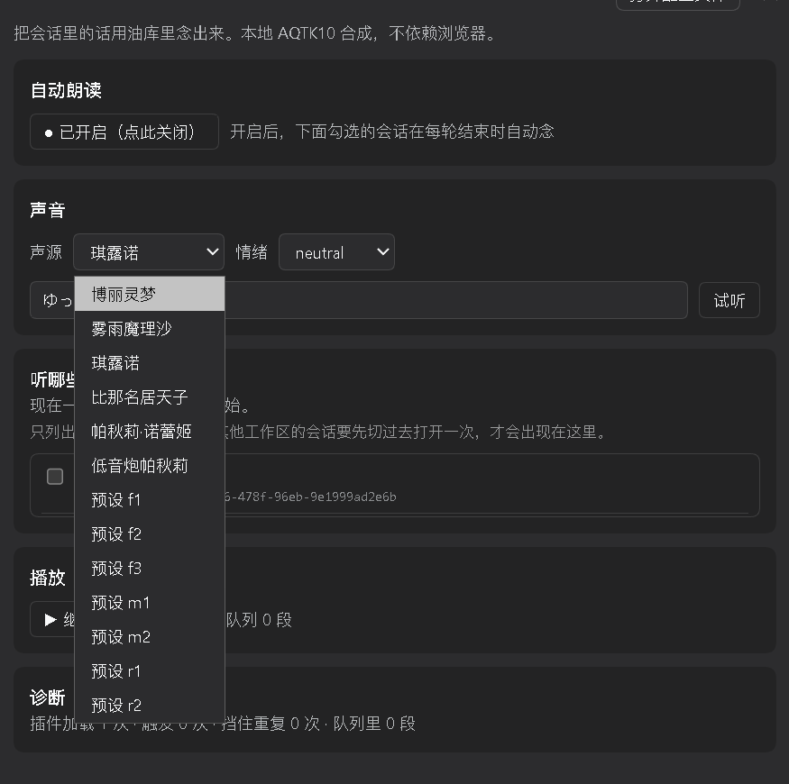

# dsh-plugin.org 收录申请（Issue 正文）

> 用法：打开 https://dsh-plugin.org/zh/submit ，把下面的模板复制到 Issue 正文里，
> 按实际情况补截图。**提交前把「提交前自查」五条逐条确认过再发。**

---

### 仓库地址

https://github.com/ODO-TECH/dsh-yukkuli

### 一句话价值

把 DeepSeek Harness 里助手说的话，用东方 Project 的油库里声线在本地念出来 —— 合成全程离线，不调用任何在线 TTS。

### 能力分类

娱乐 / 界面与体验（语音播报）

### 安装命令

```
dsh plugin --profile web add github:ODO-TECH/dsh-yukkuli
```

**不发 npm**（2026-11-18 决定）。本站 FAQ 写明：没有 npm 包的仓库**照常收录展示**（源码安装），
但不会出现在 DSH 内的「插件中心」（那里只展示 npm 一键安装）。免 npm 的另一条路是 DSH「发现」页
添加索引源 `https://odo-tech.github.io/dsh-yukkuli/market/index.json`（git 源，已上线）。

### 兼容与运行要求

- DSH：0.2.x（在 0.2.2-rc.1 上验证）
- Node.js ≥ 22
- 操作系统：目前只在 **Windows** 上验证（调用 AquesTalk 的 Windows DLL；TUI 端另需 `mpv`）
- 额外依赖：**AquesTalk SDK 需用户自行取得**（AquesTalk10 / AqKanji2Koe 两个；AquesTalk1
  那三个声线由包内 `aquestalk.js` 的 v86 在本地模拟，不用另外下载），
  仓库不附带任何 SDK 二进制或词典；SDK 路径不得含非 ASCII 字符
- 无网络调用：文本 → 假名 → 音素 → WAV 全在本地完成

### 许可证

MIT

### 截图 / 演示

设置页「油库里」面板：自动朗读开关、声源下拉（6 个东方角色 + 7 个预设）、情绪、试听、
播放队列与诊断计数。



真实输出（六个声线各一条试听 wav）：https://github.com/ODO-TECH/dsh-yukkuli/tree/main/output-chars

### 补充说明

- 仓库里有 `plugin/`（DSH 插件）与 `core/`（合成核心）两个部件，但**对外只有一个 npm 包**
  `dsh-yukkuri-tts` —— core 随包分发，不单独发。仓库根的 `package.json` 用 `dsh.bundle.patch`
  指向 `plugin/cordis.patch.yml`，所以 npm 与 `github:` 两条命令装的是同一个东西。
- 仓库名 `dsh-yukkuli` 与 npm 包名 `dsh-yukkuri-tts` 不一致（包名先定、后来改仓库名）。

### 提交前自查

- [x] 仓库已公开
- [x] 干净树已 push（95 文件 + 上架截图，标签 `v0.3.0`）
- [x] README 里包含安装命令（`dsh plugin --profile web add github:ODO-TECH/dsh-yukkuli`）
- [x] 插件导出 `apply(ctx)`
- [x] 仓库根目录有 `package.json`（声明了 `dsh.bundle.patch`）
- [x] 已给仓库打上 `dsh-plugin` topic（2026-11-18，共 5 个 topic）
- [x] description 已换成事实描述（2026-11-18）
- [x] `LICENSE` 能被识别成 MIT（2026-11-18 删追加段后 API 报 `MIT`）
